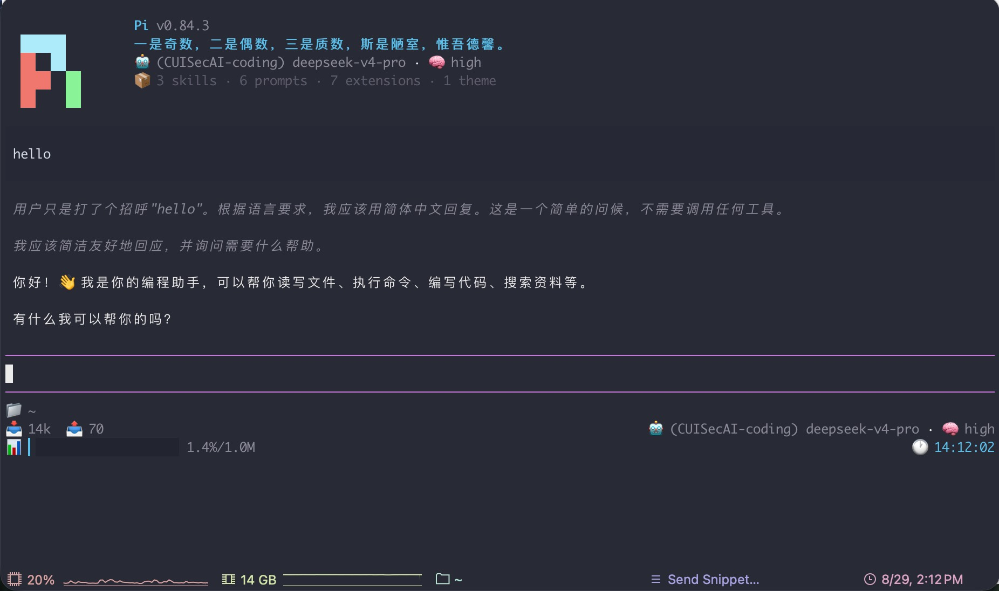

# pi-theme-skyline

一个柔和蓝色系的 pi 主题包：**skyline 配色 + 外观 extension**。



## 配色

柔和、低饱和的暗色蓝系。

| 元素 | 颜色 |
|------|------|
| 主色 / 边框 | `#5bc0eb` 天空蓝 |
| 强调（亮色） | `#8bd7f7` 亮蓝 |
| 错误 | `#e05959` 红 |
| 成功 | `#98c379` 绿 |
| 警告 | `#e5c07b` 黄 |

## 外观

安装后自动启用：

- **Header**：彩色 π logo 动画 + 版本号 + 每日鸡汤（内置语句池 + 一言接口兜底）+ 模型 / thinking 级别 + 资源统计
- **编辑器**：清爽的蓝色边框
- **Footer**：三行 —— git 详情 / token 统计 / 上下文进度条 + 实时时钟

## 安装

```bash
pi install git:github.com/se1zer/pi-theme-skyline
```

## 启用

安装后在 pi 内输入 `/settings` 选择 `skyline` 主题，或在 `~/.pi/agent/settings.json` 中设置：

```json
{
  "theme": "skyline"
}
```

## License

本项目采用 [MIT](./LICENSE) 许可证，可自由使用、修改和分发。
